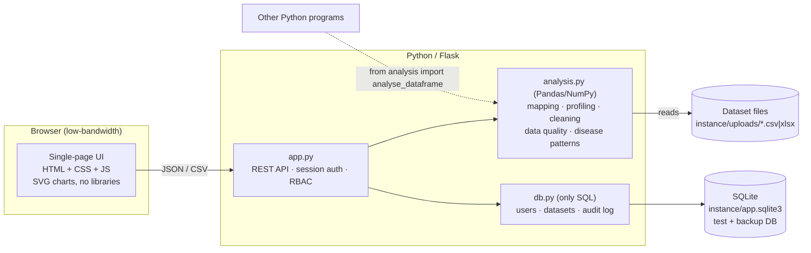
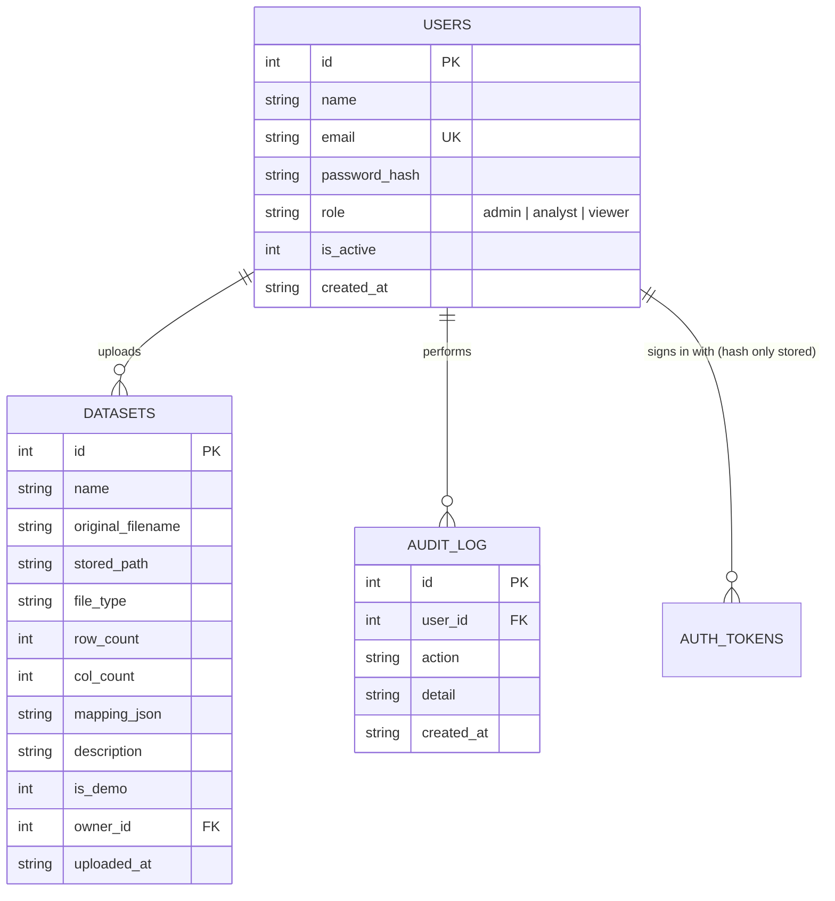
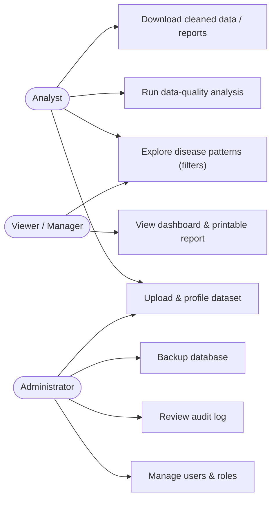
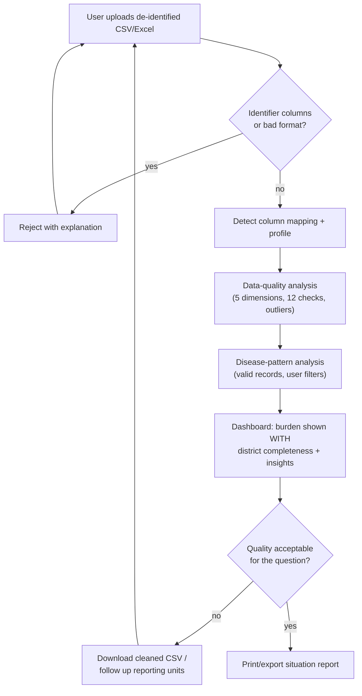
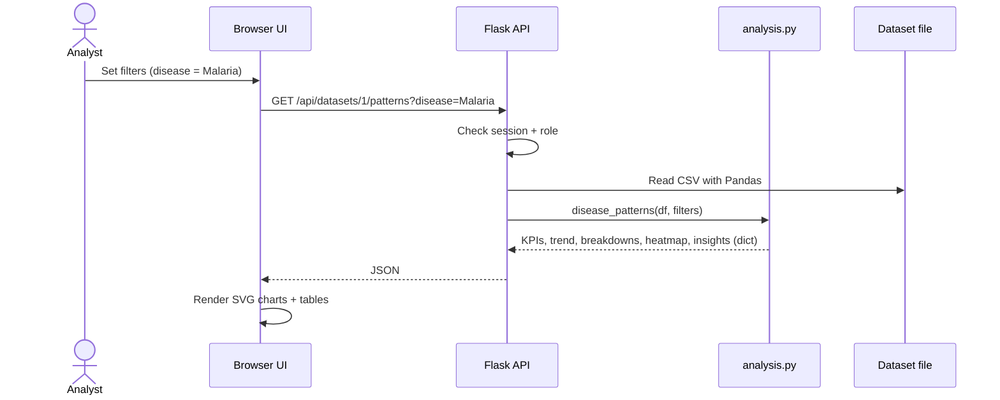
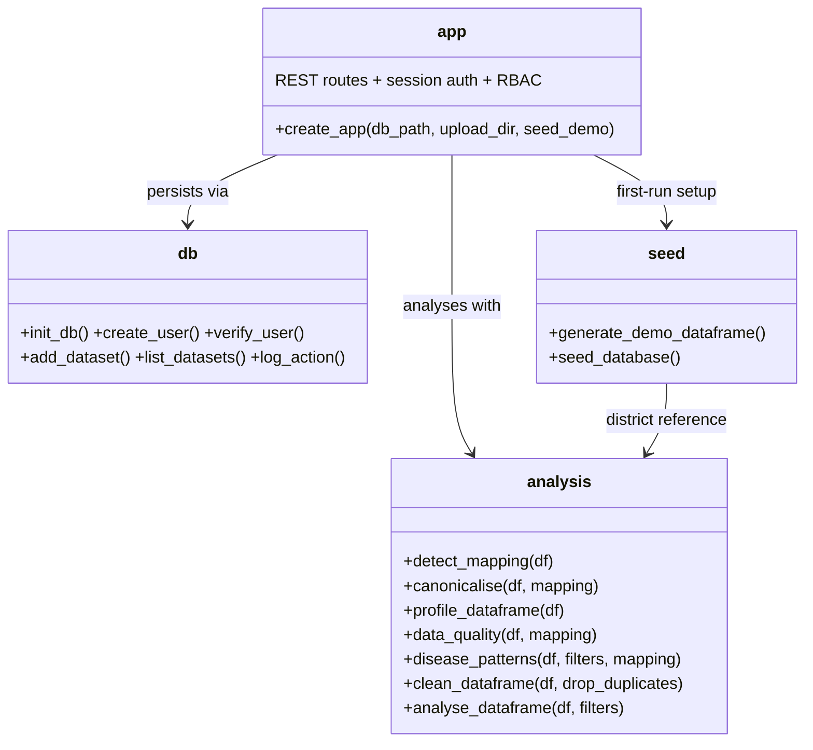

# System Design Document

**Health and Disease Analytics — Web-Based EDA Dashboard for Public Health
Data Quality and Disease Pattern Analysis in Malawi**
Eid Kusweje (24311351003) · BSc Computer Science · Guide: Mr Bester Sinkhonde

Diagrams are given as Mermaid code: paste any block into
[mermaid.live](https://mermaid.live) (or view the file on GitHub) to render
it for the final report, then export PNG/SVG for your chapter.

## 1. Requirements summary

**Functional:** FR1 role-based login (admin/analyst/viewer) · FR2 upload &
manage de-identified CSV/Excel datasets · FR3 automatic column mapping &
profiling · FR4 transparent validation/cleaning with audit-able log ·
FR5 data-quality scoring (completeness, validity, uniqueness, consistency,
timeliness, outliers) · FR6 disease-pattern exploration with filters
(disease, district, region, sex, age group, period) · FR7 charts/tables/
heatmap dashboard · FR8 printable report + CSV exports · FR9 admin user
management, audit log, database backup · FR10 REST API + importable Python
analysis module.

**Non-functional:** low-bandwidth/offline-capable UI (no external assets) ·
works on a 1366×768 laptop and small screens · strict single-palette,
single-typeface, no-gradient design system · de-identified data only
(identifier columns refused at upload) · dataset ≤ 20 MB handled in seconds
on the recommended student hardware · everything testable with pytest
without a network connection.

## 2. System architecture

Three layers; the analysis layer is pure Python with no web/database
dependencies, which is what makes it unit-testable and re-usable in other
Python programs.



**Technology choices vs. the concept document:** HTML5/CSS3/JavaScript
(frontend, as proposed) · Python + Flask (backend, as proposed) ·
Pandas/NumPy (processing, as proposed) · REST API (as proposed) ·
SQLite for the test/backup database (implementation note), with all SQL
isolated in `db.py` so PostgreSQL — the deployment database in the concept
document — can replace it without touching any other module. Charts are
hand-built SVG instead of Plotly: same visual outputs, but zero downloads,
fully offline, and still fed by the same JSON the API returns (a Plotly
client could consume that JSON unchanged). This is a deliberate
low-bandwidth decision for Malawi and should be stated in the viva.

## 3. Module design (proposal → code)

| # | Module | Implementation | Key decisions |
|---|---|---|---|
| 1 | Authentication & access control | `app.py`, `db.verify_user`, `db.create_auth_token` | PBKDF2 password hashes (Werkzeug); login returns a revocable Bearer token (SHA-256 hash in `auth_tokens`, 7-day expiry) sent as an `Authorization` header — reliable even when the dashboard is embedded cross-site and browsers block third-party cookies — with the session cookie (`SameSite=None; Secure` behind HTTPS proxies, `Lax` locally) as fallback; role decorators; viewer read-only on UI and API |
| 2 | Dataset management | `/api/datasets/*` | Files on disk, metadata in SQLite; extension/size limits; personal-identifier columns rejected |
| 3 | Validation & cleaning | `analysis.clean_dataframe` | Standardises formats & vocabularies, returns an action log; rows deleted only if the user explicitly requests duplicate removal |
| 4 | Data-quality analysis | `analysis.data_quality` | See §5 formulas |
| 5 | Disease-pattern analysis | `analysis.disease_patterns` | Monthly trend (zero-filled gaps), seasonality, district/sex/age breakdowns, district×disease heatmap |
| 6 | Dashboard & visualisation | `static/app.js` | One active dataset drives every view; charts generated as SVG from API JSON |
| 7 | Report generation & export | Reports view + `*.csv` endpoints | Print stylesheet → PDF via browser; machine-readable summary CSVs |
| 8 | Administration | `/api/admin/*` | User CRUD/activation, audit trail of logins/uploads/exports, one-click SQLite backup |

## 4. Data design

### 4.1 Entity-relationship diagram



Health records themselves are **not** stored row-by-row in the database;
each uploaded file is kept as-is and read with Pandas on demand. This
preserves the original export exactly (important for a data-quality tool:
the evidence is never altered) and keeps SQLite small and backup-friendly.

### 4.2 Accepted dataset schema (canonical fields)

`district · region · facility · disease · period_date · date_reported ·
sex · age_group · cases · deaths · population`, detected from common
aliases (`Diagnosis → disease`, `Value → cases`, …). Region is derived
from the 28-district reference table when not supplied. Without `cases`,
each row counts as one case (line-list mode).

## 5. Analytical design (formulas — cite these in the report)

* **Completeness** = % of records with *all mapped key fields* present
  (disease, district, period_date, cases, sex, age_group). Cell-level
  completeness is also reported in the dataset profile.
* **Validity** = % of records *not* flagged by: negative cases, non-numeric
  cases, future period dates, unrecognised sex, district outside the
  28 Malawi districts.
* **Uniqueness** = 100 × (1 − exact-duplicate rows beyond the first / rows).
* **Consistency** = % of records not involved in `deaths > cases`
  (valid counts only) or in a group-month submitted with conflicting totals
  (group = district+disease+facility+sex+age_group+month).
* **Timeliness** = % reported ≤ 15 days after month end, where
  `period_date` is the reporting month (WHO-style monthly reporting rule).
  *Not assessable* without both dates — the weight is then renormalised.
* **Overall score** = weighted mean: completeness 30, validity 25,
  uniqueness 20, timeliness 15, consistency 10. Bands (strict, because the
  data inform planning): **Excellent ≥ 95 · Good ≥ 85 · Fair ≥ 70 ·
  Needs attention < 70**.
* **Outliers**: beyond **3 × IQR** within the same
  disease/district/sex/age-group series. 3× (extreme) rather than 1.5× is
  used so normal rainy-season malaria peaks are not flagged. Outliers are
  listed for human verification and **do not** reduce the score.
* **Patterns**: negative and future-dated records are excluded from case
  totals (but remain visible in data-quality counts). Monthly trends
  zero-fill months with no reports so gaps are visible, not interpolated.

## 6. Behavioural diagrams

### 6.1 Use cases



### 6.2 Activity — from upload to interpretation



### 6.3 Sequence — pattern request



### 6.4 Data flow (level 0 → level 1 summary)

Level 0: *Health-data users* ↔ **EDA Dashboard** ↔ *dataset files &
SQLite store*. Level 1 processes: 1.0 Authenticate · 2.0 Import & profile ·
3.0 Validate & clean · 4.0 Assess data quality · 5.0 Analyse disease
patterns · 6.0 Present & export · 7.0 Administer. Level 2 expansion of
4.0: completeness → validity → uniqueness → consistency → timeliness →
outlier flagging → weighted score. (Draw these three DFDs directly from
the module table in §3 and formulas in §5 for the report chapter.)

### 6.5 Class/module diagram



## 7. Design-system evidence

Rules: supplied palette only · no gradients · one typeface · flat cards.
Verified on the shipped frontend (2 Nov 2026 build):

```
$ grep -rhoE "#[0-9A-Fa-f]{6}" static/ | sort -u
#5878E9  #65524D  #7FC29B  #B5EF8A  #D7F171  #FFFFFF     ← palette + white only
$ grep -rn "gradient" static/      → only the words "no gradients" in comments/help
$ grep -rn "font-family" static/   → Arial (body) + inherit — one family
$ grep -rn "https://|cdn" static/  → none — fully offline
```

RGBA values used are exactly the palette colours at reduced opacity
(101,82,77 · 88,120,233 · 127,194,155 · 181,239,138 · 215,241,113 · white).

**Colour roles:** Taupe grey = text, sidebar active state, serious/alert
states (no red anywhere) · Blue = primary actions and lead chart series ·
Muted Teal = secondary series, good status, table headers · Light Green =
page tint and soft highlights · Lime Cream = insight/demo accents and
call-to-action highlights. **Typography:** Arial only — 25/18/16 px
headings, 15–16 px body, 13–14 px captions, weights 400/700.
**Inspiration translation:** sidebar + pill nav and user card (images
1/2/6), four KPI cards with circular icon chips (image 6), trend +
right-rail summary (images 1/8), department-style statistics table
(image 6) → district burden+completeness table, print-clean report —
content re-mapped from patient/clinical widgets to the proposal's public
health data-quality/disease-pattern domain.

## 8. Security, privacy, limitations & future work

PBKDF2 hashing, parameterised SQL, upload type/size limits, identifier
column rejection, role checks on every endpoint, audit logging.
Deployment hardening (future): set `SECRET_KEY`, HTTPS via reverse proxy,
gunicorn, PostgreSQL for metadata, scheduled SQLite→server backups.
Analytical limitations: counts not population rates (no denominators yet);
timeliness assumes monthly periods; EDA cannot prove causation; dataset
size bounded by server memory (Pandas). Future work per the proposal:
DHIS2 API import, choropleth district map, rate calculations with
catchment populations, and forecasting — all natural extensions of
`analysis.py` without changing the UI contract.
